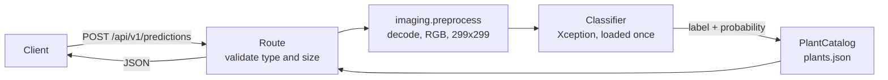

# ClassifyAI API

[](https://github.com/jaswanreddych/classifyai-api/actions/workflows/ci.yml)


A FastAPI service that identifies a medicinal plant from a photo of its leaf. Upload an image, get the top matches with confidence scores, plus the best match's scientific name, common names in several languages, and known uses.

It started as my final-year college project (a Flask page wrapped around a Keras model, 2024). This repository is the backend rebuilt as a proper service: typed request and response models, validated uploads, a model loaded once at startup, health checks, tests, CI and Docker.

```bash
curl -F "file=@leaf.jpg;type=image/jpeg" "http://localhost:8000/api/v1/predictions?top_k=3"
```

```json
{
  "predictions": [
    { "plant_id": "Tulsi", "name": "Tulsi", "scientific_name": "Ocimum tenuiflorum", "confidence": 0.7767 },
    { "plant_id": "Kambajala", "name": "Kambajala", "scientific_name": "Milicia excelsa", "confidence": 0.1581 },
    { "plant_id": "Pumpkin", "name": "Pumpkin", "scientific_name": "Cucurbita pepo", "confidence": 0.0449 }
  ],
  "low_confidence": false,
  "plant": { "id": "Tulsi", "family": "Lamiaceae", "uses": { "medicinal": ["..."], "other": ["..."] }, "...": "..." },
  "model": "xception-medicinal-leaf-78",
  "inference_ms": 734.0
}
```

Interactive docs are served at `/docs` (Swagger UI) once the server is running.

## API

| Method | Path | What it does |
|---|---|---|
| `POST` | `/api/v1/predictions` | Upload a JPEG, PNG or WebP leaf photo. `top_k` (1 to 5, default 3) sets how many matches to return. |
| `GET` | `/api/v1/plants` | List the 78 supported plants. `?q=` searches name, scientific name and common names. |
| `GET` | `/api/v1/plants/{id}` | Full details for one plant. |
| `GET` | `/health/live` | Liveness: the process is up. |
| `GET` | `/health/ready` | Readiness: `200` once the model is loaded, `503` otherwise. |

Errors always look the same, so clients only need one parser:

```json
{ "error": { "code": "unsupported_media_type", "message": "Upload a JPEG, PNG or WebP image." } }
```

| Status | `code` | When |
|---|---|---|
| 400 | `invalid_image` | The bytes are not a readable image |
| 413 | `payload_too_large` | Larger than the upload limit (5 MB by default) |
| 415 | `unsupported_media_type` | Not JPEG, PNG or WebP |
| 404 | `plant_not_found` | Unknown plant id |
| 422 | n/a | Bad query parameter or missing file (FastAPI validation) |
| 503 | `model_unavailable` | The model failed to load |

## How it works



1. The route checks the content type and reads the upload, stopping at the size limit.
2. Image decoding and the model run in a thread pool, so the event loop stays free for other requests.
3. `imaging.preprocess` turns the bytes into a `299 x 299 x 3` float array.
4. The classifier returns the top labels with probabilities.
5. Each label is looked up in the plant catalog, and the response is assembled from typed Pydantic models.

See [docs/architecture.md](docs/architecture.md) for the request sequence, module responsibilities and design decisions.

## Run it locally

Requires Python 3.11 or newer.

```bash
git clone https://github.com/jaswanreddych/classifyai-api.git
cd classifyai-api

python -m venv .venv
source .venv/bin/activate        # Windows: .venv\Scripts\activate
pip install -r requirements-ml.txt

python scripts/download_model.py  # fetches the 87 MB weights and checks the SHA-256
uvicorn app.main:app
```

Open http://localhost:8000/docs, choose `POST /api/v1/predictions`, and upload any leaf photo. Startup takes about 10 seconds while the model loads.

### Docker

The image does not contain the weights. Download them first, then mount the `models` folder:

```bash
python scripts/download_model.py
docker build -t classifyai-api .
docker run -p 8000:8000 -v "$(pwd)/models:/app/models:ro" classifyai-api
```

### Configuration

Set environment variables (or copy `.env.example` to `.env`). All are optional.

| Variable | Default | Meaning |
|---|---|---|
| `CLASSIFYAI_MAX_UPLOAD_MB` | `5` | Largest accepted upload |
| `CLASSIFYAI_LOW_CONFIDENCE_THRESHOLD` | `0.5` | Below this the response sets `low_confidence: true` |
| `CLASSIFYAI_LOG_LEVEL` | `INFO` | Logging level |
| `CLASSIFYAI_CORS_ORIGINS` | unset | JSON list of allowed origins; CORS is off if unset |

## Tests

```bash
pip install -r requirements-dev.txt
pytest                # 36 tests, no TensorFlow needed
ruff check . && ruff format --check .
```

The API tests inject a fake classifier, so they run in seconds and CI does not need TensorFlow or the weights. Two extra tests load the real model and are skipped automatically when it is not installed (`pytest -m model` runs only those).

One test checks that every label the model can output has an entry in the plant catalog. This is a real failure mode: in the original project, 18 of the 78 classes would have errored at prediction time because the label names and the plant data keys had drifted apart.

## Project layout

```
app/
  main.py            app factory, startup (loads catalog and model), middleware
  config.py          settings from environment variables
  schemas.py         request and response models
  errors.py          domain errors and the single error response shape
  api/               routes: health, plants, predictions (+ dependencies)
  services/
    classifier.py    Classifier protocol and the Keras implementation
    imaging.py       bytes -> model input array
    catalog.py       plant knowledge base and search
  data/
    plants.json      details for 78 plants
    labels.json      model output index -> label (same order as training)
models/              architecture JSON (weights are downloaded, not committed)
scripts/             download_model.py
tests/               API, catalog, imaging and model tests
training/            notebook and result charts for the model
```

## The model

- **Architecture:** Xception pretrained on ImageNet with the base frozen, plus a 128-unit dense layer, dropout and a 78-way softmax. About 21M parameters, 272k of them trained.
- **Data:** 13,806 images across 78 medicinal plant classes, built from a public Kaggle medicinal leaf dataset and balanced with augmentation. Split 70 / 10 / 20 into train, validation and test.
- **Result:** 94.8% accuracy on the held-out test split after 10 epochs ([screenshot](training/results/test-accuracy.png), [curves](training/results/training-curves.png)).

**How to read that number.** The balanced dataset contains augmented copies of the same photos, and the split was random. If a photo landed in training and its augmented copy in test, the test score is optimistic. Treat 94.8% as an upper bound on photos like the training set, not as expected accuracy on arbitrary phone photos. A fairer evaluation would split by original image before augmenting. See [training/README.md](training/README.md).

## Limitations

- Plant uses and compounds in `plants.json` were compiled by the author and have not been clinically reviewed. This is a learning project, not medical advice, and not a way to decide whether a plant is safe to eat.
- The model recognises only the 78 plants it was trained on. Anything else gets a wrong answer with some confidence, which is why the response includes `low_confidence`.
- Predictions are serialised with a lock (one at a time per process) and take roughly 0.4 to 0.7 seconds on a laptop CPU. To scale, run several worker processes or replicas.

## Possible next steps

- Re-split the dataset by original image and report a clean test score.
- Export the model to ONNX for a smaller image and faster CPU inference.
- Add request rate limiting and an API key for a public deployment.

## License

MIT, by Jaswan Reddy Ch. See [LICENSE](LICENSE).
