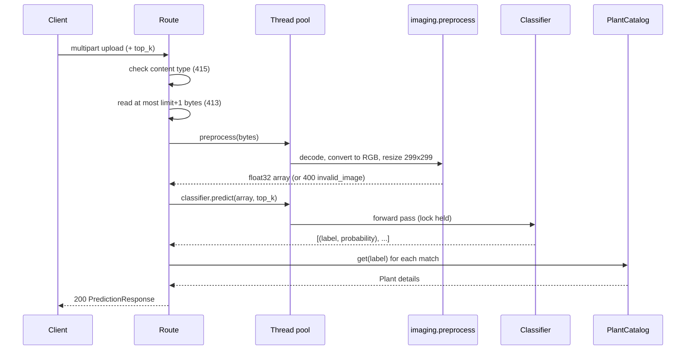

# Architecture

## Goals

- Keep the web layer thin and the model behind a small interface.
- Load the heavy model once, not per request.
- Fail clearly: validate input early, return one error shape, report readiness honestly.
- Make it testable without TensorFlow.

## Layers

| Layer | Files | Responsibility |
|---|---|---|
| Transport | `app/api/*.py` | HTTP only: parse the request, call services, return typed responses. No ML code here. |
| Services | `app/services/*.py` | Business logic: image preprocessing, classification, plant lookup. No FastAPI imports. |
| Schemas | `app/schemas.py` | The contract. Pydantic models validate data and generate the OpenAPI docs. |
| Config | `app/config.py` | Settings from environment variables, in one typed class. |
| Data | `app/data/*.json` | `labels.json` (model index to label) and `plants.json` (plant details). |

Dependencies point one way: `api` imports `services` and `schemas`; `services` never import `api`.

## Request flow: `POST /api/v1/predictions`

## Startup flow

`create_app()` builds the app; the `lifespan` function runs once at startup:

1. Load and validate `plants.json` into `PlantCatalog`. A malformed entry stops startup, so bad data is caught immediately instead of on some user's request.
2. Load `KerasClassifier` in a thread pool: rebuild the model from `model_architecture.json`, load the weights, check the output size matches `labels.json`, and run one dummy prediction so the first real request is fast.
3. If the model fails to load, log the error and stay up. `/health/live` still returns 200, `/health/ready` returns 503, and predictions return a clear `model_unavailable` error. An orchestrator can then route traffic correctly instead of seeing a crash loop with no explanation.

Both objects are stored on `app.state` and reached from routes through dependencies in `app/api/deps.py`.

## Design decisions

**A `Classifier` protocol instead of importing TensorFlow in routes.** Routes depend on "something with `predict(image, top_k)`". The real implementation imports TensorFlow lazily, and tests pass a fake. That is why 36 tests run in seconds and CI installs no ML packages.

**Blocking work runs in a thread pool.** Decoding an image and running a CNN are CPU-bound and synchronous. Calling them directly inside an `async def` route would block the event loop and stall every other request, including health checks. `run_in_threadpool` avoids that.

**One prediction at a time per process.** A lock around the model call keeps latency and memory predictable. The trade-off is throughput per process; scaling is by workers or replicas.

**Size limit enforced while reading.** The route reads at most `limit + 1` bytes. If it got the extra byte, it rejects the upload, so a huge file never sits fully in memory. Pillow's pixel limit also guards against decompression bombs.

**Do not trust the client's content type.** The `Content-Type` header is a cheap first filter, but Pillow decoding is what decides whether the bytes are a real image. Corrupt files return `400 invalid_image`.

**One error shape.** Domain errors subclass `AppError` with a status code and a machine-readable `code`; one handler formats them all.

**Labels and plant data are tied together by a test.** `labels.json` is the model's output order. `plants.json` is keyed by the same labels. A test asserts every label has a plant, so the two cannot drift apart silently.

**Readiness is separate from liveness.** Killing a process that is merely waiting for a model to load would make things worse, so the two are different endpoints.

**Weights are not in git.** An 87 MB binary bloats every clone. `scripts/download_model.py` fetches it from the GitHub release and verifies a SHA-256, so the file is both optional for development (tests do not need it) and trustworthy.

## What would change in production

- Rate limiting and an API key at the gateway.
- Metrics (request count, latency, low-confidence rate) and structured JSON logs.
- Store uploads only if needed for retraining; today images are processed in memory and never written to disk.
- A model registry or versioned artifacts instead of a single release file.
