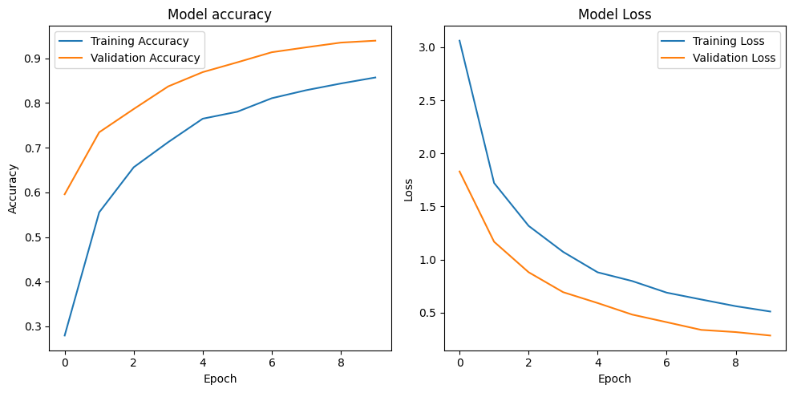

# Training

`training.ipynb` is the notebook the model was trained in. It is kept for reference and is not needed to run the API.

## What it does

1. Loads a folder-per-class image dataset (78 plants, 13,806 images) resized to 299 x 299.
2. Splits it 70% train, 10% validation, 20% test.
3. Builds Xception (ImageNet weights, frozen) with a 128-unit dense layer, dropout 0.2 and a 78-way softmax.
4. Trains for 10 epochs with Adam and sparse categorical cross-entropy.
5. Evaluates on the test split and saves the architecture (JSON) and weights (`.h5`). These are the files the API loads.

Class names come from the sorted folder names, which is how `image_dataset_from_directory` orders them. The API stores that order in `app/data/labels.json`.

## Results

| | |
|---|---|
| Test accuracy | 94.8% |
| Test loss | 0.27 |

## Caveats

- **Possible leakage.** The balanced dataset includes augmented copies of the same photo (file names containing `_aug_`), and the split is random. A photo and its augmented copy can end up in different splits, which inflates the test score.
- **Same-style data.** The photos are mostly clean, close-up shots of single leaves. Accuracy on cluttered phone photos will be lower.
- **Paths.** Dataset paths in the notebook were replaced with placeholders. Point them at your own copy of the dataset to re-run.

## To get a trustworthy number

Split by original image first, then augment only the training set, then evaluate on untouched photos (ideally some taken with a different camera).
